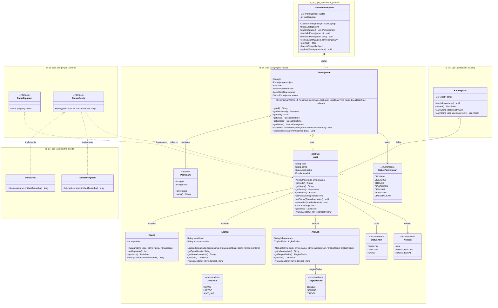

# Class Diagram - Sistem Peminjaman Aset (Aset-Pinjam)

Diagram kelas berikut memodelkan struktur kode proyek `asetpinjam` yang mencakup paket kontrak, model aset, strategi denda, katalog, dan penjadwalan.

