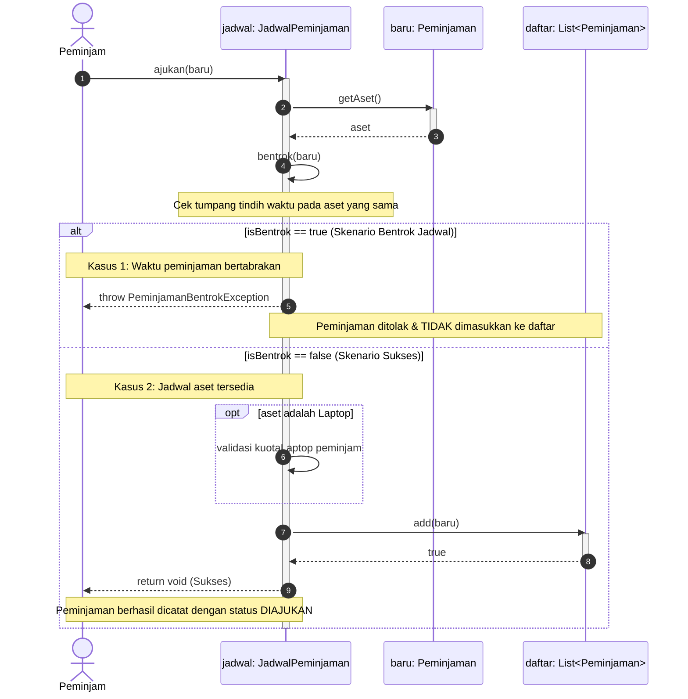

# Sequence Diagram - Pengajuan Peminjaman

Diagram interaksi berikut memodelkan alur proses pengajuan peminjaman aset pada sistem `Aset-Pinjam`, yang mencakup skenario bentrok jadwal dan skenario pengajuan berhasil menggunakan fragmen alternatif (`alt`).

